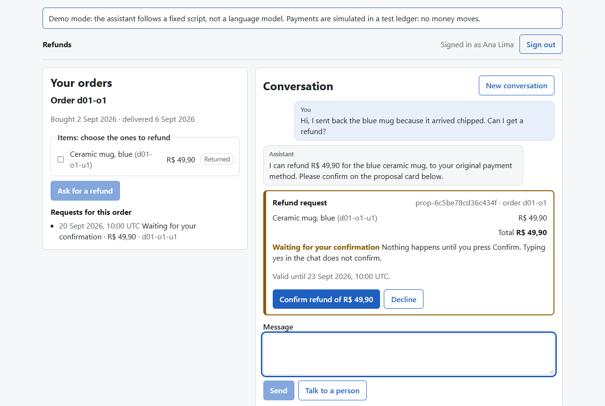
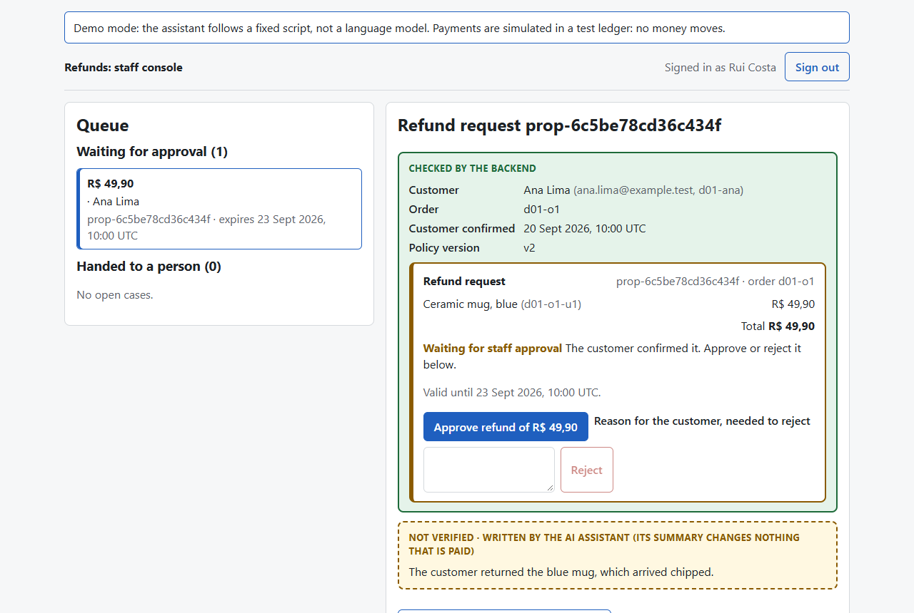
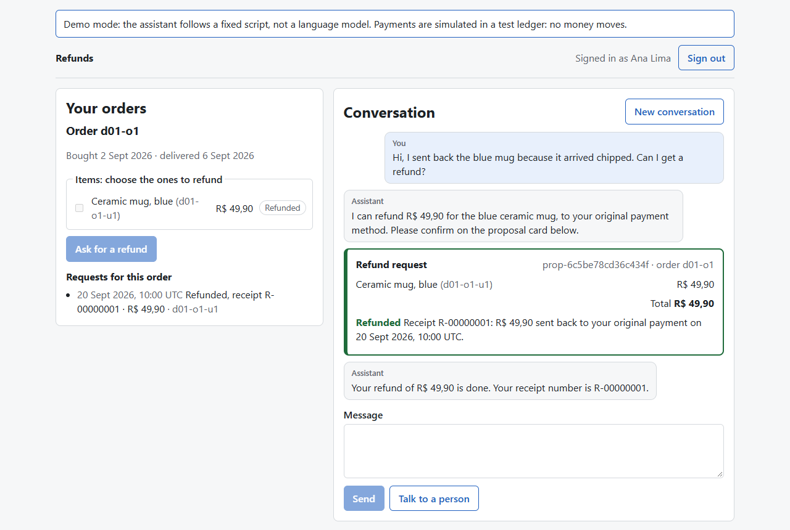

# Reliable Refund Agent

A customer-support agent that handles refund requests for a fictional online shop, and pays them, into a test
ledger, under one guarantee: no refund is paid without the customer's confirmation and a staff member's approval of
that exact proposal, and no refund is paid twice. The project shows how to let a language model take an action with
real consequences safely, and how to measure whether it does.

It runs on your own computer: a chat screen for the customer, a console for the staff member, a backend with a
PostgreSQL database, and the agent between them. It is a portfolio project and a reference design, not a hosted
service.

> **Status, 2026-11-07.** Across every evaluation run so far, no refund was paid without authorization or twice. On
> its latest unseen scenarios (39, three tries each), the agent with GPT-6.1 Sol succeeded in 109 of 117
> conversations (95% interval 85.5% to 99.1%); every failure was a missing policy citation. The release carries
> instructions repaired for those citations on development copies, not yet measured on unseen scenarios. A trial
> with five people is being prepared. Evidence by version is [below](#evidence-by-version).



## What happens in one refund

1. **The customer asks in the chat:** "I sent back the blue mug, it arrived chipped. Can I get a refund?"
2. **The agent looks up the customer's own orders** and asks the backend for a refund proposal for the mug. The
   backend, not the model, decides whether the policy allows it and computes the amount: R$ 49,90.
3. **The customer confirms with a button** on the proposal card. A "yes" typed in the chat confirms nothing.
4. **A staff member approves or rejects it** in the console, seeing the backend's figures apart from anything the
   model wrote. A rejection needs a reason, which the customer is shown.
5. **The agent asks the backend to pay.** One transaction checks everything again, writes the refund to the ledger
   and returns a receipt; asking again returns the same receipt.

When the policy refuses (too late, not returned yet, already refunded), the agent says why and cites the policy
section. When a case needs a person, or the customer asks for one, the agent hands the conversation over and makes
no further changes; the staff member continues by email ([docs/handoff.md](docs/handoff.md)).



## Why it can be trusted with money

The model proposes; the backend decides. The design rests on a few rules, each enforced in code and tested:

- **The backend is the authority.** The model's tools take only IDs and text. Ownership, the refund policy, the
  amount, the state of the request and the approval are checked by the backend's services, in the same database
  transaction that pays.
- **An approval is bound to one exact proposal and used once.** A changed order, an expired proposal or a second
  attempt cannot reuse it. Unique constraints in the database stop a unit being refunded twice, even under races.
- **Nothing the model writes grants anything.** Confirmation is the customer's button and approval is the staff
  member's action. Text from sellers, customers or the model is marked as unverified wherever it is shown.
- **A crash or a lost answer does not repeat a payment.** Every request carries an idempotency key; a retry after a
  crash returns the stored receipt.



## What is real, what is simulated

| Part | What it is |
|---|---|
| The agent | A language model (GPT-6.1 Sol, reasoning `low`, in live mode) or a fixed script per scenario (mock mode, the default), behind the same tools and backend |
| The backend, the database, the checks | Real code on a real PostgreSQL database; the checks are what the tests and the evaluations measure |
| Money | Simulated: a test ledger in the database. No payment provider, no real transfer |
| The shop, its policy, its users | Fictional. Order amounts and dates in the held-out scenarios and their copies are taken from real, anonymised Olist orders |
| Customers in the evaluations | Simulated by a language model (GPT-6 Luna) playing a written role; every conversation was then read |
| The screens | A banner on every screen says which mode is running and that payments are simulated |

## Evidence by version

Each version was measured on held-out scenarios, frozen before the run and never used for tuning. v1's were written
within the project before any live run; from v1.1 on, an independent author wrote them (another model, given only the
policy and the situations already covered). Each held-out set is spent after one run; its scenarios then become
development copies. Development results show only that the cases the rules were built from are solved.

| Version | What changed | Held-out result (three tries per scenario) | Report |
|---|---|---|---|
| v1, 2026-10-19 | First release: GPT-6 Luna, instructions v3 | 41 of 60 conversations, 11 of 20 scenarios in all three tries: **both targets missed** (51, 14). Sol: 50 of 60 | [docs/final/results.md](docs/final/results.md) |
| v1.1, 2026-10-26 | Policy v2 given in full, an assessment tool, checks of the customer's words for handoffs and item selection | Luna 40 of 60, 11 of 20 after the audit (39 and 10 as run): **targets missed**; most failures were missing citations. Sol: 51 of 60 | `runs/final-v1.1-20261026T125831Z/report.md`, [docs/v1.2/citation-rule.md](docs/v1.2/citation-rule.md) |
| v1.2, 2026-10-30 | Fixes by category of failure, instructions v9; 19 new scenarios and 8 stress scenarios | Luna 50 of 57 (87.7%), 16 of 19: **both targets met**. Sol: 54 of 57; no difference shown (+7.0 points, 95% +0.0 to +19.3). Stress set: 23 of 24 each | [docs/held-out-v1.2/results.md](docs/held-out-v1.2/results.md) |
| v1.3, 2026-11-03 | Deadlines from the backend, a wider item-selection check, instructions v10; Sol chosen as the product's model; 39 new scenarios | Sol 109 of 117 (93.2%), 35 of 39: **both targets met**. Claude Sonnet 5.5: 108 of 117; no difference shown (−0.9 points, 95% −6.8 to +5.1) at 2.54 times the agent cost. All 16 failures across both were missing citations | [docs/held-out-v1.3/results.md](docs/held-out-v1.3/results.md) |
| Release, 2026-11-06 | Instructions v12, for the citations v1.3 missed | Development only: 381 of 384 conversations on 128 scenarios; the other 3 were faults of the simulated customer | [docs/pilot/results.md](docs/pilot/results.md), "instructions v12" |

No refund was paid without authorization, or twice, in any of these runs: 180, 180, 243 and 234 conversations on the
held-out sets, and every development run. Zero observed violations do not prove zero risk; the tests below check the
same property by attacking it directly.

**A trial with people** ([docs/trial/](docs/trial/protocol.md)): five participants, each doing four tasks with the
live model, observed for where they need help and what they misread. The owner's rehearsal before it found eight
problems, none a safety problem ([docs/trial/rehearsal-2026-11-07.md](docs/trial/rehearsal-2026-11-07.md)). Its
report will give counts out of five, not a success rate.

## How it is tested

| Evidence | What it shows | Where |
|---|---|---|
| 15 failure cases | Races, crashes before and after the commit, stale approvals, forged approvals, foreign data, a restart with a pending approval | [docs/failure-cases.md](docs/failure-cases.md) |
| Authorization table, 20 cases | A forbidden call, made directly, in configurations A (all checks) and C (selected checks off), checked in the database | [docs/authorization-table.md](docs/authorization-table.md) |
| Property tests | Random sequences of actions by every party never break the invariants; planted bugs are caught | [docs/failure-cases.md](docs/failure-cases.md) |
| Browser tests | The two screens, by keyboard and mouse: a refund, a restart, a lost answer, a rejection, a handoff across a restart | [docs/screens.md](docs/screens.md), [docs/handoff.md](docs/handoff.md) |
| Scenarios with a simulated customer | 128 development scenarios; held-out sets of 20, 20, 19 (and 8 stress) and 39, each run once | [docs/scenarios.md](docs/scenarios.md) |

Each conversation is judged from the database, not from what the agent says, and then read. Targets and predictions
were written before each held-out run. The evaluation is inspired by τ-bench (pass^k is its
reliability measure), extended with application-level authorization, persistent approvals, failure recovery and
adversarial scenarios.

## Run it

### With Docker only

```bash
docker compose --profile app up --build
```

Open http://localhost:8000 and sign in as the customer or the staff member the server prints (scenario D01: Ana
Lima's mug, `ana.lima@example.test`, and Rui Costa, `rui.costa@shop.example.test`). The demo password of every
fictional user is `refund-demo-local` (`refund_agent/api/__main__.py`). One browser holds one session: use a private
window for the second person. This is mock mode: a fixed script plays the agent, no API key is needed and nothing
is spent.

Another development scenario, or the same database after a restart:

```bash
docker compose --profile app run --rm --service-ports app --scenario D05
```

```bash
docker compose --profile app run --rm --service-ports app --keep
```

Both ports are published to this computer only. `docker compose up -d` without the profile starts the database
alone, as the tests use it.

### For development

You need Docker, [uv](https://docs.astral.sh/uv/) and Node.js.

```bash
docker compose up -d
uv run python -m refund_agent.api
```

In a second terminal:

```bash
cd frontend && npm ci && npm run dev
```

Open http://localhost:5173. More in [docs/screens.md](docs/screens.md).

### With the live model

Live mode puts the evaluated agent (GPT-6.1 Sol, reasoning low, instructions v12) behind the same screens. It costs
money, so it starts only with a budget for the whole server and the date you checked the model's prices, and it
needs `OPENAI_API_KEY` in `.env`:

```bash
uv run --env-file .env python -m refund_agent.api --live --budget-usd 1 --prices-checked YYYY-MM-DD
```

The banner shows what was spent. When the budget runs out, the agent pauses and nothing is lost; start the server
again with `--keep` and a larger budget to go on ([refund_agent/api/live.py](refund_agent/api/live.py)).

### Tests

About 3,700 tests run on the local database; the browser tests need Chrome. The whole suite takes 30 to 45 minutes.

```bash
REQUIRE_DB=1 uv run pytest -q
```

```bash
npm test --prefix frontend
```

## Where things are

| Path | What it holds |
|---|---|
| `refund_agent/refunds.py` | The domain services: propose, confirm, decide, execute, cancel, hand off |
| `refund_agent/agent/` | The agent: graph, tools, model adapters, budget, notices |
| `refund_agent/api/` and `frontend/` | The HTTP layer and the two screens |
| `refund_agent/evaluation/` | Runner, evaluator, dialogue audit, final evaluation and its report |
| `scenarios/` | The development scenarios and the held-out sets |
| `prompts/` | The agent's instructions (the release uses `agent-v12.md`) and the simulated customer's |
| `docs/` | Product contract, policy, schema, state machine, plan, results and the trial |
| `Dockerfile`, `docker-compose.yml` | The demo application and the database |

## Limits

- One fictional shop, one currency (BRL), English only, and a simulated ledger: no real payment provider.
- The policy is fictional and has had no legal review. It counts a return when the shop receives it, stricter than
  the common practice of counting the sending.
- Local only. There is no public deployment. After a handoff the staff member continues by email; there is no reply
  in the chat and no list of taken cases.
- Small held-out sets (19 to 39 scenarios): the intervals are several points wide, and a result holds for these
  scenarios, not for every shop.
- The simulated customer is a language model; some conversations failed because it broke its role, and are reported
  as such. Claude read every conversation; the owner read a share of v1's, and later readings were waived or are
  still pending, as each report records.
- Some checks of the customer's words (which item among look-alikes, a request for a person) are bounded word rules:
  they fail safe, by asking again or refusing, and a typo can make them ask twice.
- Language models are not deterministic: a new run with the same settings can answer differently. The reports are
  reproducible from the saved results.

## Data and licences

The code is under the [MIT licence](LICENSE). The Olist orders in `data/olist/`, and every scenario fixture that
copies numbers from them, are under CC BY-NC-SA 4.0, from the Brazilian E-Commerce Public Dataset by Olist
([data/olist/README.md](data/olist/README.md)).
