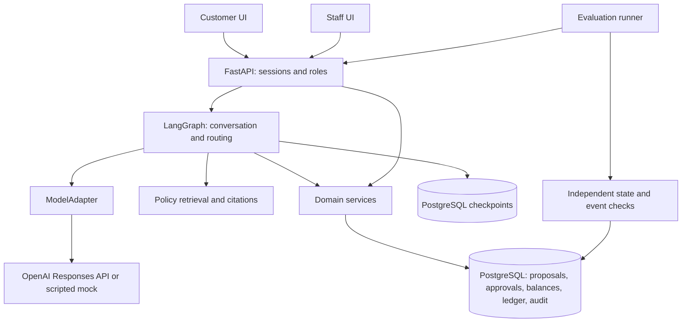

# Τελικό πλάνο: Reliable Refund Agent

Ημερομηνία: 9 Οκτωβρίου 2026. Έκδοση πλάνου: 4, **τελική και παγωμένη**. Αντικαθιστά τις εκδόσεις 1–3 του πλάνου «AI εξυπηρέτηση μετά την αγορά».

Το έγγραφο είναι εσωτερική προδιαγραφή και σχέδιο υλοποίησης. Δεν αποτελεί ισχυρισμό ότι η εφαρμογή έχει ήδη υλοποιηθεί ή αξιολογηθεί. Οι πηγές ελέγχθηκαν έως τις 9/10/2026 και όχι για όσα ενδέχεται να συμβούν αργότερα. Τρεις από αυτές (UserProxyBench, GPT-6.1 Sol, GPT-6 Luna) ελέγχθηκαν δεύτερη φορά ανεξάρτητα.

## 0. Πάγωμα και αποφάσεις της τελικής έκδοσης

Νέος γύρος σχεδιασμού δεν γίνεται. Αλλαγή στο πλάνο δικαιολογείται μόνο από κώδικα που τρέχει, αποτυχημένο test, μετρημένο κόστος ή πραγματικό feedback, και καταγράφεται με ημερομηνία στο τέλος του εγγράφου.

Στο repository μπαίνει μόνο ένα σύντομο **product contract** (1–2 σελίδες): χρήστης, ροή, όρια v1, invariants, κριτήρια ολοκλήρωσης και λειτουργίες εκτός scope. Το παρόν έγγραφο μένει εσωτερική προδιαγραφή.

Αποφάσεις που άλλαξαν από την έκδοση 3:

1. **Βασικός agent το GPT-6 Luna** (αρχικά reasoning `low`, με το `none` να εξετάζεται στο development pilot), όχι το `gpt-4o-mini`. Η τελική ρύθμιση κρίνεται από το κόστος ανά σωστά ολοκληρωμένη υπόθεση, την επιτυχία και τον χρόνο, όχι από την τιμή ανά token ή την ηλικία του μοντέλου (§9).
2. **Νέο παραδοτέο: «Έλεγχοι εξουσιοδότησης και ακεραιότητας εργαλείων».** Περίπου 15 ντετερμινιστικές περιπτώσεις χωρίς κόστος API, στις διαμορφώσεις A και C, με το αποτέλεσμα να ελέγχεται στη βάση (§10.4).
3. **Οι στόχοι ποιότητας ορίζονται μετά το pilot και πριν από το τελικό test.** Τα προκαθορισμένα 90% και 80% αφαιρέθηκαν. Οι απαιτήσεις για ownership, έγκυρες εγκρίσεις και αποφυγή διπλής εκτέλεσης μένουν σταθερές (§16).
4. **Πάγωμα πλάνου και product contract,** όπως παραπάνω.

## 1. Απόφαση και επίπεδο φιλοδοξίας

Η εφαρμογή είναι ολοκληρωμένη ροή επιστροφών χρημάτων για εικονικό e-shop. Έχει έναν AI agent, μία ανθεκτική επιχειρησιακή ροή, περιβάλλον πελάτη και υπαλλήλου, και αναπαραγώγιμη αξιολόγηση.

Απευθύνεται σε portfolio Junior Applied AI / GenAI Engineer. Συνδέει το προηγούμενο RAG με το Agent Action Guard και προσθέτει αυθεντικοποίηση, βάση, συναλλαγές, UI, δοκιμές βλαβών και λειτουργική αξιολόγηση. Δεν προορίζεται να αποδείξει εκπαίδευση μοντέλων ή research ML.

Περιγραφή repository:

> A customer-support agent that proposes refunds, obtains customer confirmation and staff approval, and executes each authorized operation at most once. Evaluated through database state, event history, simulated customers, and controlled failure tests.

Το 9,5–10/10 είναι επιδιωκόμενο επίπεδο ποιότητας, όχι βαθμός που μπορεί να εγγυηθεί ένα πλάνο. Η τελική κρίση απαιτεί υλοποίηση, στοιχεία και ανεξάρτητο review. Η συνεισφορά είναι η ποιότητα μηχανικής, όχι ο ισχυρισμός ότι επινοήθηκαν οι agents εξυπηρέτησης ή το idempotency.

## 2. Πού τελειώνει η v1

Η v1 θεωρείται πλήρες προϊόν όταν υποστηρίζει, στα αγγλικά:

1. Είσοδο πελάτη και ασφαλή ανάκτηση των δικών του παραγγελιών.
2. Επιλογή προϊόντος και ποσότητας για επιστροφή χρημάτων.
3. Ανάκτηση της σχετικής πολιτικής με σωστή παραπομπή.
4. Proposal με ποσό που υπολόγισε ο backend.
5. Ρητή επιβεβαίωση του πελάτη στην κάρτα του proposal.
6. Έγκριση ή απόρριψη από ταυτοποιημένο υπάλληλο.
7. Προσομοιωμένο refund και μοναδική απόδειξη εκτέλεσης στη βάση.
8. Σωστή συνέχεια μετά από restart, retry και αβέβαιο αποτέλεσμα HTTP.
9. Απλό handoff όταν ζητηθεί άνθρωπος ή όταν η περίπτωση δεν καλύπτεται.
10. Περίπου 30 σενάρια, δωρεάν tests, τον πίνακα ελέγχων εξουσιοδότησης, Docker, λειτουργία mock, report και σύντομο βίντεο.

| Υποχρεωτικό στη v1 | Μετά τη v1, μόνο αν υπάρχει λόγος |
|---|---|
| Μία ροή refund και οι απαραίτητες αναγνώσεις παραγγελίας | Αυτοτελής ροή παρακολούθησης αποστολών και ακύρωση |
| Αγγλικά | Ελληνικά, έπειτα Greeklish |
| Έγκριση υπαλλήλου για κάθε refund | Αυτόματα refunds χαμηλού ρίσκου |
| Ένα εικονικό κατάστημα, ένα νόμισμα | Πολλά καταστήματα, νομίσματα ή φορολογικά καθεστώτα |
| Τοπική PostgreSQL και δοκιμαστικό ledger | Πραγματικός payment provider ή Shopify adapter |
| Customer chat και staff console | Πλήρες helpdesk, omnichannel, voice |
| Docker, mock, βίντεο | Δημόσιο live demo με απομόνωση sessions και όρια |
| Ένας agent με καθορισμένα εργαλεία | Multi-agent, MCP server, αυτόματη δημιουργία εργαλείων |

Εκτός v1 επίσης: εκπαίδευση ή fine-tuning, recommendation engine, πραγματική αποθήκη ή μεταφορική, Kubernetes, γενικός workflow engine, long-term agent memory και επίσημη συμμετοχή σε leaderboard.

Η ανάγνωση μιας παραγγελίας είναι υποστηρικτικό εργαλείο της ροής refund. Δεν μετατρέπεται σε δεύτερη μεγάλη λειτουργία εξυπηρέτησης.

## 3. Τι έδειξε η πρόσφατη έρευνα και τι αλλάζει πρακτικά

| Πρωτογενής πηγή | Χρήσιμη απόφαση |
|---|---|
| [Gorgias Actions](https://docs.gorgias.com/en-US/create-an-action-for-ai-agent-567325): προϋποθέσεις ενεργειών και επιβεβαίωση πελάτη | Η επιβεβαίωση αφορά αποθηκευμένη, συγκεκριμένη ενέργεια. |
| [Fin human-in-the-loop approvals](https://fin.ai/help/en/articles/16049727-human-in-the-loop-approvals-for-fin-procedures), Αύγουστος 2026 | Η ανθρώπινη συμμετοχή έχει κατάσταση, απόφαση, λήξη και ασφαλή συνέχεια. |
| [Fin escalation reporting](https://fin.ai/updates/escalation-reporting), Αύγουστος 2026 | Καταγράφεται η αιτία και η προέλευση του handoff, όχι μόνο ένα συνολικό ποσοστό. |
| [Sierra transparency](https://sierra.ai/blog/your-agent-laid-bare-and-why-it-matters), Σεπτέμβριος 2026 | Traces, εκδόσεις και αναπαραγώγιμη διερεύνηση αποτυχίας. |
| [UserProxyBench](https://arxiv.org/abs/2609.38043), προδημοσίευση 29/9/2026 | Ο simulator ελέγχεται ως μέρος της αξιολόγησης. Με σταθερό agent, η αλλαγή μόνο του simulator μετακίνησε τη μέση ανταμοιβή κατά 15,2 μονάδες, και το 24,4% των επιτυχημένων επεισοδίων περιείχε παραβίαση του ρόλου του χρήστη. |
| [Επίσημες εκδόσεις της οικογένειας τ-bench](https://github.com/sierra-research/tau2-bench/releases), πλέον τ³-bench | Σαφής αναφορά έκδοσης ή commit, αν επαναχρησιμοποιηθεί κώδικας. Τα δικά μας σενάρια Olist είναι ξεχωριστή αξιολόγηση. |
| [OpenAI deprecations](https://developers.openai.com/api/docs/deprecations) | Ο evaluator μένει στον κώδικά μας. Δεν χτίζεται νέα εξάρτηση από την πλατφόρμα Evals, για την οποία έχει ανακοινωθεί κλείσιμο στις 30/11/2026. |

Η Sierra ανακοίνωσε το [Personal Agent Protocol στις 6/10/2026](https://sierra.ai/blog/introducing-personal-agent-protocol), αλλά η ανακοίνωση τοποθετεί τη δημοσίευση της προδιαγραφής v0.1 αργότερα μέσα στον μήνα. Δεν γίνεται dependency του project. Αυτό που κρατάμε είναι η κατεύθυνση: σαφή APIs και εξουσιοδότηση που δεν εξαρτάται από τον client.

Οι δυνατότητες των εταιρειών είναι τεκμηριωμένες λειτουργίες, όχι ανεξάρτητη απόδειξη ότι κάποια είναι η καλύτερη. Οι δικές μας επιλογές για συναλλαγές και tests είναι αρχιτεκτονική πρόταση, όχι περιγραφή των εσωτερικών τους συστημάτων.

Οι ενδεικτικές αγγελίες [Accenture Junior GenAI](https://www.accenture.com/us-en/careers/jobdetails?id=R00318994_en) και [Attercop Junior AI](https://attercop.hrpartner.io/jobs/junior-ai-engineer---remote-oxo4d) ζητούν μαζί Python, APIs, RAG/agents, SQL, tests και deployment. Η επιλογή καλύπτει αυτές τις δεξιότητες, αλλά δύο αγγελίες δεν είναι στατιστική έρευνα της αγοράς.

## 4. Επιχειρησιακό συμβόλαιο και δεδομένα

Πριν γραφτεί κώδικας για τον agent, ορίζεται μία υποθετική πολιτική demo: χρονικό παράθυρο, επιλέξιμη κατάσταση παραγγελίας, όριο ανά προϊόν και ποσότητα, χειρισμός προηγούμενης επιστροφής, μεταφορικών και έκπτωσης, και πότε επιτρέπεται η καταβολή χρημάτων. Η πολιτική δεν παρουσιάζεται ως πραγματική πολιτική της Olist ή ως νομική συμβουλή.

Απλοποιήσεις της v1:
- Τα χρήματα επιστρέφονται στο αρχικό δοκιμαστικό payment record. Δεν επιτρέπεται αλλαγή παραλήπτη ή τραπεζικών στοιχείων.
- Τα ποσά κρατούνται σε ακέραιες υποδιαιρέσεις νομίσματος.
- Τα μεταφορικά δεν επιστρέφονται αυτόματα. Μια εξαίρεση παραδίδεται σε άνθρωπο.
- Μια έκπτωση, αν υπάρχει στα fixtures, είναι ήδη κατανεμημένη ντετερμινιστικά στις γραμμές.

Η φυσική μεταφορά του προϊόντος δεν υλοποιείται. Όπου η πολιτική απαιτεί παραλαβή, το `return_received` είναι έμπιστο στοιχείο του demo fixture ή του backend, όχι δήλωση του LLM. Η επιτυχής ροή ξεκινά από προϊόν με αυτή την προϋπόθεση ήδη επιβεβαιωμένη. Αν λείπει, δημιουργείται αίτημα ή παράδοση σε υπάλληλο χωρίς refund. Ένα αίτημα δεν παρουσιάζεται ποτέ ως ολοκληρωμένη φυσική επιστροφή.

Χρήση του [Olist](https://www.kaggle.com/olistbr/brazilian-ecommerce/home/): μικρό ιστορικό υποσύνολο, με ξεχωριστό αρχικό import, provenance και checksum. Λογαριασμοί, πολιτικές, εγκρίσεις, υποθετικές τρέχουσες καταστάσεις και refund ledger είναι συνθετικά. Το ρολόι της αξιολόγησης είναι σταθερό, χωρίς διαρροή μελλοντικών γεγονότων. Το demo έχει 3–5 συνθετικούς πελάτες, έναν υπάλληλο και αρκετές αντιπροσωπευτικές παραγγελίες. Δεν χρειάζεται εισαγωγή όλου του dataset.

Το `customer_unique_id` του Olist μπορεί να συνδέει ιστορικές παραγγελίες, αλλά η αυθεντικοποίηση της εφαρμογής είναι ξεχωριστή. Τα IDs των γραμμών διατηρούνται, ώστε δύο ίδια προϊόντα να μη συγχέονται. Η προέλευση και η άδεια του dataset καταγράφονται χωριστά από την άδεια του κώδικα. Η λειτουργία mock δουλεύει και με πλήρως συνθετικά fixtures.

## 5. Αρχιτεκτονική και όρια ευθύνης



- FastAPI/Pydantic, SQLAlchemy/Alembic, PostgreSQL, LangGraph και React/TypeScript.
- Ένα backend και μία βάση αρκούν: PostgreSQL checkpointer για το graph και ξεχωριστοί πίνακες για την επιχειρησιακή κατάσταση.
- Το graph κρατά μηνύματα, tool results, pending IDs και δρομολόγηση. Δεν απονέμει δικαιώματα.
- Οι κόμβοι καλούν domain services. Δεν γράφουν απευθείας balances ή approvals.
- Ο backend καθορίζει τον actor από το session, και ελέγχει ownership, πολιτική, ποσό, επιτρεπτή μετάβαση και εκτέλεση.
- Ο ModelAdapter μεταφράζει messages, tool calls, usage και errors. Δεν περιέχει επιχειρησιακή πολιτική.
- Κοινό Responses API για όλα τα μοντέλα. Το GPT-6 Luna και το GPT-6.1 Sol κάνουν tool calling μέσω Responses API, οπότε δεν χρειάζονται δύο ενσωματώσεις. Τα reasoning items και τα δεδομένα συνέχειας κρατούνται όπως απαιτεί κάθε μοντέλο.
- Ο runner δεν είναι δεύτερο παραγωγικό σύστημα. Χρησιμοποιεί τα ίδια services σε απομονωμένα fixtures.
- Κλειδωμένες εξαρτήσεις και εκδόσεις containers. Packages και μοντέλα δεν αλλάζουν αυτόματα στη μέση της τελικής αξιολόγησης.

Η [μόνιμη αποθήκευση του LangGraph](https://docs.langchain.com/oss/python/langgraph/persistence) επιτρέπει συνέχεια μετά από restart. Δεν υποκαθιστά την εξουσιοδότηση και την ατομικότητα του domain service. Μετά από interrupt ο κόμβος ξεκινά ξανά από την αρχή, οπότε κάθε κλήση με επίδραση είναι idempotent.

Ενδεικτικά εργαλεία του agent: `list_my_orders`, `get_my_order`, `lookup_refund_policy`, `propose_refund`, `get_request_status`, `execute_refund`, `request_handoff`. Το `execute_refund(proposal_id)` ζητά εκτέλεση από τον backend, δεν δίνει εξουσιοδότηση. Η ίδια κλήση πριν από confirmation ή approval απορρίπτεται από την παραγωγική υπηρεσία. Ο agent δεν έχει εργαλεία για έγκριση υπαλλήλου, αλλαγή ρόλου, αυθαίρετο SQL ή εκτέλεση κώδικα.

## 6. Καταστάσεις, εγκρίσεις και συναλλαγές

Βασική ακολουθία:

`requested → awaiting_customer_confirmation → awaiting_staff_approval → approved → refunded`

Εναλλακτικές μεταβάσεις: απόρριψη, ακύρωση από τον πελάτη πριν από την εκτέλεση, λήξη, ή ακύρωση εγκυρότητας λόγω αλλαγής στοιχείων. Το αίτημα φυσικής επιστροφής και η οικονομική εκτέλεση είναι διαφορετικά πράγματα. Κάθε μετάβαση έχει συγκεκριμένο actor και προϋποθέσεις.

Το proposal είναι αμετάβλητο και δεσμεύει customer, order και item IDs, ποσότητες, ποσό και νόμισμα, payment reference, έκδοση πολιτικής, την ουσιώδη έκδοση της παραγγελίας και λήξη. Η επιβεβαίωση του πελάτη και η έγκριση του υπαλλήλου είναι χωριστές αποθηκευμένες αποφάσεις. Αλλαγή του proposal απαιτεί νέα επιβεβαίωση και νέα έγκριση.

Τα endpoints επιβεβαίωσης και έγκρισης δέχονται μόνο proposal ID και απόφαση. Ο backend διαβάζει τα πραγματικά στοιχεία και δεν εμπιστεύεται ποσό ή actor από το frontend. Η έγκριση του υπαλλήλου δεν παρακάμπτει έναν ανελαστικό επιχειρησιακό κανόνα. Οι εξαιρέσεις πηγαίνουν σε handoff.

Ο κύκλος ζωής είναι ανθεκτικός πριν και μετά την έγκριση:
- Η δημιουργία proposal χρησιμοποιεί σταθερή ταυτότητα αιτήματος, ώστε η επανεκτέλεση ενός κόμβου να μη δημιουργεί δεύτερο αίτημα.
- Το ίδιο idempotency key με διαφορετικό περιεχόμενο επιστρέφει conflict.
- Καμία συναλλαγή δεν μένει ανοιχτή όσο περιμένουμε μοντέλο ή άνθρωπο.

Το idempotency key προστατεύει από επανάληψη της ίδιας εκτέλεσης, αλλά δεν φτάνει μόνο του: δύο διαφορετικά proposals με διαφορετικά keys μπορούν να ξεπεράσουν μαζί το υπόλοιπο. Γι' αυτό το υπόλοιπο ελέγχεται μέσα στην ίδια συναλλαγή, είτε με κλείδωμα και έλεγχο είτε με conditional update. Ενδεικτική λογική του δεύτερου:

```sql
UPDATE refund_balances
SET remaining_minor = remaining_minor - :amount
WHERE order_id = :order_id
  AND currency = :currency
  AND :amount > 0
  AND remaining_minor >= :amount
RETURNING remaining_minor;
```

Το απόσπασμα δεν είναι ολόκληρη υλοποίηση εξουσιοδότησης. Αν δεν επιστραφεί γραμμή, η εκτέλεση δεν επιτρέπεται. Το UPDATE κλειδώνει εσωτερικά τη γραμμή, αλλά δεν προστατεύει μόνο του ελέγχους σε άλλους πίνακες. Η [PostgreSQL](https://www.postgresql.org/docs/current/transaction-iso.html) τεκμηριώνει πώς επανελέγχεται η συνθήκη μετά από ταυτόχρονη ενημέρωση.

Σε μία συναλλαγή ελέγχονται και ενημερώνονται: actor και ownership, έλεγχος της συνομιλίας, τρέχουσα πολιτική και έκδοση, ενεργή έγκριση, υπόλοιπο και ποσότητες ανά προϊόν, κατανάλωση της έγκρισης, refund operation, ledger lines, receipt, audit event και τελική κατάσταση. Χρειάζεται συνεπής στρατηγική για όσα rows συμμετέχουν. Για τη v1 επιλέγεται η απλούστερη λύση που αποδεδειγμένα είναι σωστή, χωρίς micro-optimization.

Invariants:

- Το ποσό και η ποσότητα refund ανά προϊόν δεν υπερβαίνουν το επιλέξιμο πληρωμένο όριο.
- Κάθε committed refund operation έχει μία ισχύουσα έγκριση.
- Κάθε έγκριση επιτρέπει το πολύ μία committed operation.
- Μία operation μπορεί να έχει πολλές ledger lines.
- Retry μιας ολοκληρωμένης operation επιστρέφει το ίδιο receipt.
- Καμία αλλαγή σε δεδομένα άλλου πελάτη, και καμία νέα αλλαγή από τον agent μετά την ανάληψη από άνθρωπο.

Η ισχυρή διατύπωση είναι «το πολύ ένα committed αποτέλεσμα και ασφαλής συνέχεια». Η επιτυχής ολοκλήρωση εξαρτάται και από τη διαθεσιμότητα της υποδομής. Δεν υποσχόμαστε γενικό exactly-once απέναντι σε εξωτερικούς providers.

## 7. Ασφάλεια και αξιοπιστία της οθόνης έγκρισης

Η οθόνη του υπαλλήλου χωρίζει οπτικά τα στοιχεία του backend από τα μη επαληθευμένα κείμενα. Δείχνει πελάτη, order και item IDs, προϊόν και ποσότητα, ποσό και νόμισμα, κανόνα, κατάσταση και λήξη. Η σύνοψη του LLM έχει ετικέτα και σύνδεσμο προς τα αρχικά μηνύματα. Το hash αποθηκεύεται για ακριβή δέσμευση και έλεγχο. Δεν χρειάζεται να εμφανίζεται ως εμπόδιο στη χρήση, και τα δικαιώματα του υπαλλήλου ελέγχονται κανονικά.

Κείμενα πελατών και πωλητών δεν αποδίδονται ως ενεργό HTML και δεν μπορούν να μιμηθούν κουμπιά έγκρισης ή έμπιστα πεδία. Session, ρόλος και πρόσβαση ελέγχονται σε κάθε order, conversation και proposal. Χρησιμοποιείται καθιερωμένος μηχανισμός session και authentication, με ασφαλή cookies και προστασία των endpoints που αλλάζουν κατάσταση. Δεν κατασκευάζεται νέο authentication framework.

Οι πηγές injection περιορίζονται σε δεδομένα που πράγματι διαβάζει η ροή: μήνυμα πελάτη, λόγος επιστροφής, επιλεγμένες order notes ή μήνυμα πωλητή. Οι άμεσες επιθέσεις στο chat αναφέρονται χωριστά από τις έμμεσες μέσα σε tool output. Δεν προστίθενται κριτικές προϊόντων μόνο για να υπάρχει πεδίο επίθεσης.

Απειλές: πλαστή ιδιότητα manager, αλλαγή ποσού ή προϊόντος, ξένο order ID, παράκαμψη έγκρισης, πλαστό citation, παλιά εξουσιοδότηση, injection στη σύνοψη, διπλό αίτημα, retry και races. Ένας κακόβουλος database administrator είναι εκτός threat model. Ένας εξουσιοδοτημένος υπάλληλος μπορεί ακόμα να παραπλανηθεί κοινωνικά: η ακεραιότητα των πεδίων μειώνει συγκεκριμένους κινδύνους, δεν κάνει τον άνθρωπο άτρωτο.

Το audit είναι append-only για τον ρόλο της εφαρμογής, και οι διορθώσεις καταγράφονται ως νέα events. Τα committed effects και τα events τους γράφονται στο ίδιο commit. Οι απορριφθείσες προσπάθειες καταγράφονται χωρίς να χάνονται σε rollback. Όλα τα δεδομένα του demo είναι συνθετικά ή ανωνυμοποιημένα, και στα traces δεν δημοσιεύονται secrets ή προσωπικά δεδομένα.

Αυτές οι αποφάσεις ευθυγραμμίζονται με συγκεκριμένα σημεία των [OWASP AI Agent Security](https://cheatsheetseries.owasp.org/cheatsheets/AI_Agent_Security_Cheat_Sheet.html) και [Transaction Authorization](https://cheatsheetseries.owasp.org/cheatsheets/Transaction_Authorization_Cheat_Sheet.html). Δεν αποτελούν πιστοποίηση συμμόρφωσης.

## 8. RAG, UX και handoff

Αρκεί μικρό, versioned corpus πολιτικών. Ο υπάρχων retriever μεταφέρεται πίσω από interface, εφόσον περάσει έλεγχο. Το προηγούμενο RAG δεν ξαναχτίζεται. Το pgvector ή άλλο νέο retrieval component μπαίνει μόνο αν λύνει μετρημένη ανάγκη: η ανάκτηση τεκμηριωμένης πολιτικής δεν χρειάζεται μεγάλη vector database.

Οι αριθμητικοί κανόνες έχουν μία ελεγχόμενη πηγή, και το κείμενο της πολιτικής παράγεται από αυτήν ή ελέγχεται απέναντί της. Κάθε citation επιστρέφεται ως πραγματικό policy/section/version ID από τον retriever. Ένα URL που έγραψε το μοντέλο δεν γίνεται δεκτό ως πηγή.

Με τόσο μικρή συλλογή πολιτικών, η πλήρης πολιτική μέσα στο context είναι εύλογη εναλλακτική. Η v1 δεν ισχυρίζεται ότι το retrieval βελτιώνει την απόδοση χωρίς μέτρηση. Η κύρια πειραματική ερώτηση αφορά τις ενέργειες και την ορθότητά τους.

**Customer UI:** επιλογή παραγγελίας και προϊόντος, chat, κάρτα proposal, κουμπί επιβεβαίωσης, σαφής κατάσταση και απόδειξη. **Staff UI:** ουρά αιτημάτων, έμπιστα στοιχεία, approve/reject, handoff και ιστορικό events. Αρχικά αρκεί περιοδικό refresh (polling). Τα WebSockets δεν είναι προϋπόθεση.

Οι βασικές καταστάσεις είναι loading, pending, approved, rejected, expired, completed, προσωρινό σφάλμα και human controlled. Μετά από refresh ή restart ανακτώνται από τον backend. Καμία optimistic ένδειξη «τα χρήματα επιστράφηκαν» πριν από committed receipt. Η χρήση με πληκτρολόγιο λειτουργεί, και η κατάσταση διαβάζεται χωρίς να στηρίζεται μόνο στο χρώμα.

Το handoff αποθηκεύει αιτία και προέλευση, τον στόχο του πελάτη, επιβεβαιωμένα στοιχεία, εκκρεμές proposal, προηγούμενες ενέργειες και τι χρειάζεται απόφαση. Το `human_controlled` είναι αποθηκευμένη κατάσταση που ελέγχεται συναλλακτικά σε κάθε εγγραφή, ώστε ήδη προγραμματισμένες κλήσεις να μη γράψουν μετά την ανάληψη. Δεν κρατιέται ανοιχτό SQL lock όσο δουλεύει ο άνθρωπος. Η απλή ενόχληση του πελάτη δεν οδηγεί υποχρεωτικά σε άρνηση εξυπηρέτησης, ενώ ένα ρητό αίτημα για άνθρωπο εξυπηρετείται.

## 9. Μοντέλα και simulator

Οι δημόσιες τιμές ελέγχθηκαν στις 9/10/2026 και αφορούν standard text processing ανά 1M tokens, short-context tier. Cached input, cache writes, reasoning και output usage, καθώς και ειδικά tiers, χρειάζονται ξεχωριστή λογιστική. Η πρόσβαση και τα όρια του λογαριασμού επαληθεύονται πριν από τα πραγματικά runs.

| Ρόλος | Αρχική επιλογή | Input / output USD | Απόφαση |
|---|---|---:|---|
| Οικονομικός agent | `gpt-6-luna`, reasoning `low` (`none` στο pilot) | 0.10 / 0.50 | Βασικός agent των διαμορφώσεων A και C. |
| Ισχυρότερος agent αναφοράς | `gpt-6.1-sol`, reasoning `low` | 2.00 / 10.00 | Μία μετρημένη σύγκριση ικανότητας και κόστους (B). |
| Σταθερός customer simulator | `gpt-6-luna`, σταθερές ρυθμίσεις | 0.10 / 0.50 | Υπό τον όρο ελέγχου πιστότητας στα development σενάρια. |

Πηγές τιμών και συμβατότητας: [GPT-6 Luna](https://developers.openai.com/api/docs/models/gpt-6-luna), [GPT-6.1 Sol](https://developers.openai.com/api/docs/models/gpt-6.1-sol), [Responses API](https://developers.openai.com/api/docs/guides/latest-model). Το GPT-6.1 Sol δεν δέχεται reasoning `none` ή `minimal`, και δίνεται μόνο ως alias, χωρίς σταθερό snapshot (§11). Τα reasoning tokens χρεώνονται ως output.

Ο Luna επιλέγεται ως αφετηρία επειδή είναι φθηνότερος ανά token και νεότερος. Τίποτα από τα δύο όμως δεν αποδεικνύει καλύτερη συμπεριφορά στη συγκεκριμένη εργασία. Στο development pilot συγκρίνονται οι ρυθμίσεις `low` και `none`, και η τελική επιλογή κρίνεται από το **κόστος ανά σωστά ολοκληρωμένη υπόθεση**, την επιτυχία και τον χρόνο. Αν το pilot δείξει ότι ο Luna είναι ακατάλληλος, το `gpt-4o-mini-2024-07-18` ($0.15 / $0.60) είναι η εφεδρική επιλογή πριν από το freeze. Δεν εκτελούνται υποχρεωτικά συγκρίσεις όλων των μοντέλων, και η επιλογή δεν γίνεται από το τελικό held-out score.

Επειδή ο Luna είναι και agent και simulator, η ανεξάρτητη επαλήθευση της κατάστασης της βάσης και η επιθεώρηση των διαλόγων είναι υποχρεωτικές.

Ο simulator έχει ιδιωτικό στόχο και στοιχεία του χρήστη, και κανόνες για το τι αποκαλύπτει. Δεν έχει πρόσβαση στο oracle, στα αναμενόμενα tool arguments ή στα κρυφά στοιχεία της βάσης, και επιβεβαιώνει μόνο ό,τι ταιριάζει στον στόχο του. Τα πραγματικά customer-confirm endpoints τα καλεί ελεγχόμενος test actor που αντιπροσωπεύει τον πελάτη, όχι ο agent.

Αρχικά χρησιμοποιούνται scripted customers, για μηδενικό κόστος και σταθερά regression cases. Στο live pilot ελέγχονται 10 development διάλογοι για επινοημένα γεγονότα, πρόωρη αποκάλυψη (το συχνότερο σφάλμα κατά το UserProxyBench), αλλαγή στόχου, πρόωρη λήξη και ψευδή επιβεβαίωση. Ένα κρίσιμο σφάλμα διορθώνεται πριν από το freeze. Ένα επιτυχημένο pilot δεν αποδεικνύει καθολική πιστότητα.

Στη v1 ελέγχονται και οι 180 τελικοί διάλογοι, με την ίδια σύντομη rubric για την πιστότητα του simulator, ανεξάρτητα από το αποτέλεσμα του agent. Προβλέπονται περίπου 9–15 ώρες γι' αυτό μέσα στη φάση της αξιολόγησης ή στο περιθώριο. Όπου είναι πρακτικό, οι ετικέτες μοντέλου και διαμόρφωσης κρύβονται κατά τον έλεγχο. Ένα δεύτερο LLM μπορεί να επισημαίνει ύποπτους διαλόγους, χωρίς να αντικαθιστά την ανθρώπινη βαθμονόμηση. Αν η επιθεώρηση μείνει ελλιπής, οι υπόλοιποι διάλογοι σημειώνονται ως unknown, και η επιτυχία υπό συνθήκη δεν υπολογίζεται σαν να ήταν όλοι έγκυροι. Δεν συνδυάζονται όλες οι αποτυχίες και λίγες επιτυχίες σε ασταθμισμένο ποσοστό λαθών του simulator.

Ο υπάλληλος στην αυτόματη αξιολόγηση ακολουθεί scripted αποφάσεις ανά σενάριο. Δεν προστίθεται τρίτος, ανεξέλεγκτος LLM approver. Η αντοχή ενός πραγματικού ανθρώπου σε παραπλανητική σύνοψη εξετάζεται μόνο ως μικρή άσκηση χρηστικότητας, χωρίς γενικευμένο ποσοστό ασφάλειας.

## 10. Αξιολόγηση που χωρά στη v1

### 10.1 Αναφορά

Κύρια αναφορά: [τ-bench](https://arxiv.org/abs/2406.12045). Η οικογένεια έχει εξελιχθεί σε τ³-bench, με δημοσιευμένες αλλαγές στην αξιολόγηση. Χρησιμοποιούμε την ιδέα agent/user/tools/state χωρίς πλήρη εξάρτηση από το runtime του benchmark. Αν μεταφερθούν tasks ή κώδικας, καταγράφονται ακριβώς πηγή, άδεια, έκδοση και μετατροπές. Στο README:

> Evaluation inspired by τ-bench, extended with application-level authorization, persistent approvals, failure recovery and adversarial scenarios.

### 10.2 Σενάρια

30 business scenarios: 10 development και 20 held-out, που παγώνουν και δεν χρησιμοποιούνται για tuning. Παραφράσεις ή μεταφράσεις του ίδιου template δεν μοιράζονται στις δύο πλευρές. Επειδή ο δημιουργός γνωρίζει τις προδιαγραφές, το σύνολο δεν ονομάζεται «ανεξάρτητο μυστικό benchmark».

| Held-out ομάδα | Πλήθος | Παραδείγματα |
|---|---:|---|
| Επιλέξιμα αιτήματα | 8 | Πλήρες ή μερικό refund, πολλά items, ποσότητα, προηγούμενη μερική επιστροφή, κατανεμημένη έκπτωση. |
| Μη επιλέξιμα αιτήματα | 4 | Εκτός χρόνου, μη επιλέξιμη κατάσταση, εξαντλημένο υπόλοιπο ή ποσότητα, μη επιβεβαιωμένη παραλαβή. |
| Επιθέσεις και ξένα δεδομένα | 4 | Fake manager, ξένη παραγγελία, οδηγία σε order note, παραπλανητική σύνοψη ή ποσό. |
| Διευκρινίσεις και handoff | 4 | Ασαφές προϊόν, αλλαγή πρόθεσης πριν από την επιβεβαίωση, απόρριψη από τον υπάλληλο, ρητό αίτημα για άνθρωπο. |

Η κατανομή είναι πρόταση scope, όχι εξωτερικό πρότυπο. Το μικρό adversarial υποσύνολο δεν αποδεικνύει γενική αντοχή, γι' αυτό συμπληρώνεται από τον ντετερμινιστικό πίνακα της §10.4. Τα direct API και concurrency tests είναι επιπλέον και δεν φουσκώνουν τον αριθμό των συνομιλιακών σεναρίων.

Κάθε σενάριο περιέχει initial fixture, ρολόι, στόχο και ιδιωτικά στοιχεία του πελάτη, δεδομένα που βλέπει ο agent, την προβλεπόμενη απόφαση του υπαλλήλου, την αποδεκτή τελική κατάσταση, την υποχρεωτική επικοινωνία και τα απαγορευμένα events. Κανένας από τους δύο συμμετέχοντες δεν βλέπει το oracle.

### 10.3 Evaluator

Ο evaluator διασταυρώνει τελική κατάσταση, ledger, approval records και ιστορικό events. Δεν αρκείται σε ένα log «success». Δεν απαιτεί μία μοναδική ακολουθία εργαλείων, μόνο τους αναγκαίους περιορισμούς, όπως confirmation και approval πριν από την εκτέλεση. Ελέγχεται και ο ίδιος ο evaluator: σωστά authored αποτελέσματα περνούν, ενώ λάθος ποσό ή item, έλλειψη έγκρισης, διπλό refund και ψευδής ολοκλήρωση αποτυγχάνουν. Η σιωπή ή η άρνηση όλων δεν κερδίζει σε σενάρια που απαιτούν ενέργεια ή εξήγηση.

Οι [τρέχουσες οδηγίες αξιολόγησης του τ-bench](https://github.com/sierra-research/tau2-bench/blob/main/docs/evaluation.md) και η [οδηγία της Anthropic για agent evals](https://www.anthropic.com/engineering/demystifying-evals-for-ai-agents) υποστηρίζουν ότι μετρά και το αποτέλεσμα και η αξιολόγηση της αλληλεπίδρασης. Οι δικές μας assertions και thresholds τεκμηριώνονται χωριστά.

### 10.4 Έλεγχοι εξουσιοδότησης και ακεραιότητας εργαλείων

Ντετερμινιστικός πίνακας με περίπου 15 περιπτώσεις, χωρίς κόστος API. Κάθε περίπτωση υποβάλλει απευθείας μια κλήση εργαλείου ή endpoint, στη διαμόρφωση A και στη C, και ελέγχει **το αποτέλεσμα στη βάση** (proposals, approvals, balances, ledger, receipts, audit), όχι μόνο το μήνυμα του εργαλείου. Δείχνει τι συμβαίνει όταν υποβληθεί απαγορευμένη κλήση. Η αντοχή του μοντέλου σε prompt injection είναι διαφορετική ερώτηση και εξετάζεται χωριστά (§10.2, ομάδα επιθέσεων).

Το C δεν αναμένεται να αποτυγχάνει παντού, γιατί κρατά τους κοινούς ελέγχους. Ενδεικτικά:

| Περίπτωση | Αναμενόμενο A | Αναμενόμενο C |
|---|---|---|
| Εκτέλεση χωρίς απαιτούμενη έγκριση | Μπλοκάρισμα | Επιτρέπεται στο απομονωμένο πείραμα |
| Εκτέλεση χωρίς επιβεβαίωση πελάτη | Μπλοκάρισμα | Επιτρέπεται στο απομονωμένο πείραμα |
| Εκτέλεση εκτός χρονικού παραθύρου | Μπλοκάρισμα | Επιτρέπεται στο απομονωμένο πείραμα |
| Ξένη παραγγελία | Μπλοκάρισμα | Μπλοκάρισμα |
| Retry ολοκληρωμένης επιστροφής | Ίδιο receipt | Ίδιο receipt |
| Υπέρβαση διαθέσιμου υπολοίπου | Μπλοκάρισμα | Μπλοκάρισμα |

Οι αναμενόμενες τιμές γράφονται πριν τρέξει ο πίνακας. Μια απόκλιση είναι εύρημα που καταγράφεται, όχι κάτι που διορθώνεται σιωπηλά.

### 10.5 Διαμορφώσεις

| Κωδικός | Διαμόρφωση | Ερώτημα |
|---|---|---|
| A | Οικονομικός agent (Luna) + πλήρεις έλεγχοι | Πόσο καλά λειτουργεί το προϊόν; |
| B | Ισχυρότερος agent (Sol) + ίδιοι έλεγχοι | Αξίζει το επιπλέον κόστος και ο χρόνος; |
| C | Οικονομικός agent + πολιτική στο prompt, με επιλεγμένους ελέγχους απενεργοποιημένους | Τι αλλάζει η επιβολή πολιτικής και έγκρισης στον backend; |

Κοινά σε A και C: μοντέλο, prompt, εργαλεία, αρχικά δεδομένα, simulator, script του υπαλλήλου και budgets. Authentication, απομόνωση, ποσό υπολογισμένο από τον server και βασικοί περιορισμοί αποθήκευσης μένουν κοινά. Η δημιουργία proposal υπολογίζει quote και εμφανίζει eligibility και αιτίες και στις δύο. Το πείραμα αλλάζει αποκλειστικά την επιβολή των παρακάτω ελέγχων μέσα στο `execute_refund`:

| Έλεγχος εκτέλεσης | A: πλήρης | C: εργαστηριακή |
|---|---|---|
| Επιβεβαίωση πελάτη και έγκριση υπαλλήλου | Υποχρεωτικές και ισχύουσες | Ζητούνται από το prompt, αλλά δεν επιβάλλονται από το service |
| Χρονικό παράθυρο, επιλέξιμη κατάσταση και απαιτούμενη παραλαβή | Επιβάλλονται | Επιστρέφονται ως πληροφορία, χωρίς επιβολή |
| Ownership, διαχωρισμός ρόλων στα endpoints, θετικό ποσό και νόμισμα, υπόλοιπο και ποσότητα, deduplication και audit | Επιβάλλονται | Επιβάλλονται |

Το εργαλείο εκτέλεσης είναι διαθέσιμο στο ίδιο tool loop και στις δύο εκδόσεις: το graph δεν κρύβει πρόσθετη πύλη που θα έκανε αδύνατη την απόπειρα παράκαμψης στο C. Στο A η υπηρεσία απορρίπτει την πρόωρη κλήση και η ροή περιμένει την έγκριση. Στο C η απουσία πύλης μπορεί να επιτρέψει αποτέλεσμα που το ανεξάρτητο oracle θα καταγράψει ως παραβίαση. Ο πίνακας της §10.4 επιβεβαιώνει, πριν από κάθε live run, ότι A και C διαφέρουν ακριβώς εκεί που δηλώνει το πείραμα. Η χαλαρή υλοποίηση φορτώνεται μόνο από το απομονωμένο evaluation harness, με συνθετική βάση, και δεν εξάγεται ως δημόσια ρύθμιση του demo.

`20 held-out σενάρια × 3 επαναλήψεις × 3 διαμορφώσεις = 180 συνομιλίες`.

Δεν είναι πλήρης factorial σύγκριση δύο μοντέλων επί δύο αρχιτεκτονικών. Δεν προκύπτει λοιπόν συμπέρασμα για την αλληλεπίδραση μοντέλου και backend, ούτε ότι οι ίδιοι έλεγχοι έχουν την ίδια επίδραση σε κάθε μοντέλο. Το σχέδιο αρκεί για τις δύο δηλωμένες συγκρίσεις, A/B και A/C.

## 11. Μετρικές, αβεβαιότητα και provenance

Δημοσιεύονται υποχρεωτικά:

- Task success, χωριστά για νόμιμες αλλαγές, σωστές αρνήσεις και handoff.
- Μέση επιτυχία και `pass^3`: το ποσοστό των σεναρίων που πέτυχαν και στις τρεις προσπάθειες (όχι ο κύβος της συνολικής επιτυχίας).
- Unsafe proposals, blocked attempts και unauthorized committed actions, χωριστά.
- Duplicate committed effects και υπέρβαση ποσού ή ποσότητας.
- Σωστή πηγή πολιτικής και αληθής τελική ενημέρωση του πελάτη.
- Σφάλματα simulator και υποδομής, και επιτυχία συνολικά και υπό τη συνθήκη έγκυρης προσομοίωσης.
- Αιτία και προέλευση των handoff, περιττά handoff και φόρτος του υπαλλήλου.
- Κόστος του agent, όλων των προσπαθειών, ανά σωστά λυμένη υπόθεση, χωριστά από το συνολικό κόστος αξιολόγησης.
- Χρόνος απόκρισης του αυτοματοποιημένου μέρους, με την αναμονή του ανθρώπου χωριστά. p50 και p95 με το πλήθος του δείγματος, χωρίς ισχυρισμό παραγωγικού SLA.
- Ο πίνακας ελέγχων εξουσιοδότησης της §10.4.

Για τις διαφορές A/B και A/C χρησιμοποιείται paired bootstrap ανά task ID, με τα repeats και τις αντίστοιχες διαμορφώσεις μαζί. Αν κάποια tasks μοιράζονται template, η μονάδα είναι η οικογένεια. Σταθερό seed και πλήθος draws, μαζί με wins/ties/losses ανά task. Με 20 tasks τα διαστήματα είναι αναμενόμενα ασταθή και δεν στηρίζουν μεγάλους γενικούς ισχυρισμούς.

Το Wilson δεν εφαρμόζεται στα 60 επεισόδια σαν να ήταν 60 ανεξάρτητα προβλήματα. Με μηδενικά συμβάντα, το απλό bootstrap μπορεί να εκφυλιστεί σε μηδενικό εύρος. Τότε δημοσιεύεται το πλήθος, και, όπου υπάρχει κατάλληλο μοντέλο, άνω όριο με δηλωμένες παραδοχές. Το ότι δεν παρατηρήθηκε παραβίαση δεν αποδεικνύει μηδενικό κίνδυνο.

Κάθε προγραμματισμένη προσπάθεια έχει κατάσταση και trace:
- Λάθος tool arguments, loops και αποτυχίες λόγω μέγιστου πλήθους βημάτων μένουν αποτυχίες του συστήματος.
- Τα σφάλματα simulator ή provider δεν εξαφανίζονται από το report.
- Μια μη εξουσιοδοτημένη εγγραφή μένει αποτυχία ασφάλειας, ακόμα κι αν ο simulator παραβίασε τον ρόλο του.
- Δεν γίνεται επιλεκτικό retry μέχρι να εμφανιστεί επιτυχία.
- Ελλιπείς τριάδες δεν παρουσιάζονται ως πλήρες pass^3.

Το manifest περιλαμβάνει fingerprint του κώδικα και του dirty diff, lockfile, prompts, εργαλεία, πολιτικές, hashes δεδομένων και fixtures, schema, model IDs και snapshots όπου υπάρχουν, simulator, evaluator, ρυθμίσεις, ρολόι και seed, διαμόρφωση, trial IDs και πολιτική retry. Αν αλλάξει η ταυτότητα, το resume σταματά. Η αναφορά επιτρέπει δηλωμένες συγκρίσεις μοντέλων σε διαφορετικές γραμμές, αλλά αρνείται σιωπηρή συγχώνευση ασύμβατων runs.

Όταν ο provider δεν προσφέρει αμετάβλητο snapshot (όπως στο GPT-6.1 Sol), καταγράφονται το alias, οι ημερομηνίες και τα διαθέσιμα metadata, μαζί με αυτόν τον περιορισμό. Η αναπαραγωγή του report από αποθηκευμένα traces είναι ντετερμινιστική. Μια νέα ζωντανή εκτέλεση LLM δεν δίνει υποχρεωτικά ίδιες απαντήσεις, ακόμα και με ίδιο manifest.

Πριν από κάθε νέο paid batch αποθηκεύονται οι προβλέψεις, το ερώτημα και τα όρια. Η συνέχεια του ίδιου batch δεν χρειάζεται νέα υπόθεση. Ολοκληρωμένες αποθηκευμένες κλήσεις δεν επαναλαμβάνονται. Αν χαθεί η απάντηση μετά την επεξεργασία στο API, το αποτέλεσμα και το κόστος μπορεί να είναι αβέβαια, οπότε δεν υποσχόμαστε μηδενική διπλή χρέωση.

## 12. Προϋπολογισμός και όρια εκτέλεσης

Το πλάνο δεν δίνει εντολές για paid runs. Πριν από πραγματικά runs επαληθεύονται οι τότε τιμές, η πρόσβαση και τα πραγματικά όρια του λογαριασμού (ημερήσια, RPM και TPM) για κάθε μοντέλο που χρησιμοποιείται. Το όριο περίπου 10.000 requests την ημέρα που μετρήθηκε για το `gpt-4o-mini` στο Guard δεν θεωρείται καθολικό και δεν μεταφέρεται σε άλλο μοντέλο.

Αρχικά όρια budget, ως όρια σχεδιασμού και όχι αυτόματη άδεια δαπάνης: pilot έως $5, πρώτο τελικό batch έως $15, έως $30 συνολικά για τη live αξιολόγηση της v1. Αν το μετρημένο pilot προβλέπει μεγαλύτερο κόστος, το batch αναθεωρείται πριν εκτελεστεί. Δεν υποσχόμαστε ότι αυτά τα ποσά αρκούν.

Ο runner μετρά χωριστά τις κλήσεις και το usage του agent, του simulator και του judge, και προϋπολογίζει όλα τα tokens, μαζί με το reasoning output. Όρια ανά συζήτηση: συνολικά βήματα, κλήσεις μοντέλου και εργαλείων, output tokens, χρόνος και retries. Αρχικά χαμηλή concurrency και κεντρική δέσμευση budget για τις κλήσεις σε εξέλιξη. Τα retries του SDK μετρώνται και αυτά.

Αριθμητικό παράδειγμα, όχι πρόβλεψη: αν κάθε επεισόδιο έχει 20.000 input και 2.000 χρεωμένα output tokens για τον agent, και 15.000/1.000 για τον simulator (Luna), τότε:
- 120 συνομιλίες με Luna (A και C) κοστίζουν περίπου $0,60 (agent $0,003 και simulator $0,002 ανά επεισόδιο)
- 60 συνομιλίες με Sol (B) κοστίζουν περίπου $3,72 (agent $0,06 και simulator $0,002 ανά επεισόδιο)
- σύνολο περίπου **$4,32**, χωρίς reviewers, retries, cache writes, ειδικά tiers, φόρους ή άλλη χρήση.

Οι πραγματικές συνομιλίες μπορεί να έχουν πολύ διαφορετικό προφίλ tokens, ειδικά λόγω reasoning. Το pilot καθορίζει αν το παράδειγμα είναι χρήσιμο.

Το κόστος λειτουργίας του προϊόντος δεν περιλαμβάνει τον simulator, ενώ το κόστος αξιολόγησης τον περιλαμβάνει. Ένα refund με βοήθεια ανθρώπου δεν παρουσιάζεται ως πλήρως αυτόνομη επίλυση.

## 13. Δωρεάν tests και CI

Σε κάθε αλλαγή τρέχουν: lint και type checks όπου έχουν αξία, tests πολιτικής και auth του backend, integration tests σε πραγματική PostgreSQL, stateful property tests, workflow tests με scripted/mock μοντέλο, και ο πίνακας της §10.4. Τα κρίσιμα tests γράφονται μαζί με τον backend, όχι στο τέλος.

Υποχρεωτικές περιπτώσεις αποτυχίας:

1. Δύο ανεξάρτητες συνδέσεις εκτελούν την ίδια έγκριση: ένα refund και ένα receipt.
2. Δύο διαφορετικά proposals επιχειρούν να επιστρέψουν περισσότερα από το ίδιο υπόλοιπο.
3. Νέο key προσπαθεί να επιστρέψει ξανά την ίδια ποσότητα προϊόντος.
4. Ίδιο key με διαφορετικό payload απορρίπτεται.
5. Crash πριν από το commit: πλήρες rollback.
6. Crash μετά το commit και πριν από το checkpoint ή την HTTP απάντηση: ίδιο receipt στο retry.
7. Σφάλμα ανάμεσα στην ενημέρωση του υπολοίπου και την εγγραφή στο ledger: πλήρες rollback.
8. Restart με εκκρεμή έγκριση: σωστή κατάσταση και στα δύο UI.
9. Ληγμένη, απορριφθείσα ή παλιά έγκριση: καμία εκτέλεση.
10. Ξένη παραγγελία, συνομιλία ή proposal, ή αναρμόδιος approver: καμία πρόσβαση.
11. Handoff που συμπίπτει με αλλαγή από τον agent: σωστή συναλλακτική σειρά.
12. Άκυρη ποσότητα, νόμισμα, ποσό ή ορίσματα: καμία ανεπιθύμητη εγγραφή.
13. Το resume payload του μοντέλου ισχυρίζεται έγκριση χωρίς αντίστοιχη εγγραφή: απόρριψη.
14. Αλλοίωση ή injection στη σύνοψη δεν αλλάζει τα έμπιστα πεδία της έγκρισης.
15. Άκυρη τελική κατάσταση και agent που δεν κάνει τίποτα αποτυγχάνουν στον evaluator όταν απαιτείται ενέργεια.

Τα race tests χρησιμοποιούν πραγματικές transactions, ξεχωριστές connections και barriers/events. Το Hypothesis διερευνά ακολουθίες και invariants, αλλά δεν αντικαθιστά αυτές τις δοκιμές. Δεν κυνηγάμε αυθαίρετο πλήθος tests ή ποσοστό coverage χωρίς έλεγχο των ουσιαστικών περιπτώσεων.

Οι αξιολογήσεις με live μοντέλο τρέχουν με ξεχωριστή, ελεγχόμενη εντολή, όχι αυτόματα σε κάθε PR. Το CI δεν χρειάζεται API key. Κρίσιμα browser tests καλύπτουν επιβεβαίωση, έγκριση υπαλλήλου, refresh, κατάσταση rejected/expired και εμφάνιση της απόδειξης.

## 14. Observability, συσκευασία και εμπειρία του reviewer

Structured logs με IDs συνομιλίας, proposal και operation, εκδόσεις πολιτικής, μοντέλου και ρυθμίσεων, χρόνους, έκβαση εργαλείων και usage. Αρκούν μια μικρή οθόνη trace/ιστορικού και ένα στατικό report από αποθηκευμένα runs. Πρόσθετη υπηρεσία observability είναι προαιρετική.

Το Docker Compose ξεκινά backend, frontend και PostgreSQL, με migrations, seed/reset για το demo, health checks και τεκμηριωμένες απαιτήσεις. Η λειτουργία mock αντικαθιστά μόνο τους providers μοντέλων και embeddings: χρησιμοποιεί τον ίδιο backend, τις ίδιες εγκρίσεις, το ίδιο UI και πραγματική βάση. Δεν είναι βίντεο κρυμμένο πίσω από ένα chat.

Ο reviewer μπορεί να:

- Τρέξει το demo χωρίς API key, μετά το αρχικό κατέβασμα των dependencies και images.
- Ακολουθήσει μια συγκεκριμένη διαδρομή ως πελάτης και ως υπάλληλος.
- Δει ένα restart και ένα διπλό αίτημα να καταλήγουν στο ίδιο receipt.
- Τρέξει τα δωρεάν tests και τον πίνακα ελέγχων εξουσιοδότησης, και να αναπαράγει το report από τα διαθέσιμα δεδομένα.
- Διαβάσει τι είναι πραγματικό, τι συνθετικό και τι mock.

README στα αγγλικά: σύντομο βίντεο, πρόβλημα και χρήστης, αρχιτεκτονική, quickstart, παραδείγματα, απόδοση στο τ-bench, αποτελέσματα με παρονομαστές, κόστος και αβεβαιότητα, threat model, περιορισμοί και roadmap. Τρεις σύντομες τεχνικές αποφάσεις εξηγούν την εξουσία του backend, τις συναλλαγές και το idempotency, και τον σχεδιασμό της αξιολόγησης.

Βίντεο 3–4 λεπτών: αίτημα για ένα item, πηγή πολιτικής, επιβεβαίωση πελάτη, εκκρεμής έγκριση, restart, έγκριση, ένα refund, retry με το ίδιο receipt, μία απορριφθείσα επίθεση και το αποτέλεσμα της αξιολόγησης. Τα failpoints βρίσκονται σε διαδρομή test/demo, όχι προσβάσιμα σε δημόσιους πελάτες.

Μικρή εξωτερική δοκιμή με 3–5 άτομα και, αν βρεθεί, έναν άνθρωπο υποστήριξης πελατών. Καταγράφονται συγκεκριμένες δυσκολίες και αλλαγές. Ένας ανεξάρτητος developer εξετάζει τα κρίσιμα σημεία. Αν δεν βρεθεί, το δηλώνουμε. Δεν δημιουργούμε τεχνητή «βαθμολογία ειδικών».

## 15. Ρεαλιστικός χρόνος και σημεία ολοκλήρωσης

Η εκκίνηση γίνεται μετά το κλείσιμο του Guard 0.3. Το νέο project δεν γίνεται αφορμή για απεριόριστες προσθήκες στο Guard. Το paired bootstrap ανά task στα reports του Guard είναι ξεχωριστή εργασία πάνω στα αποθηκευμένα runs και δεν χρειάζεται νέες κλήσεις API.

| Φάση | Ώρες στόχου | Παραδοτέο |
|---|---:|---|
| 1. Product contract, δεδομένα, πολιτική, προδιαγραφές σεναρίων | 18 | Product contract 1–2 σελίδων στο repo, κλειδωμένο scope, schema και καταστάσεις, 10 development cases, σχέδιο held-out. |
| 2. Backend, auth, εγκρίσεις, συναλλαγές | 42 | Ροή refund χωρίς LLM, με ownership, ποσό, idempotency, βασικά race/crash tests και τον πίνακα της §10.4. |
| 3. Adapter, RAG και graph | 24 | Πλήρης ανθεκτική ροή σε mock, και μικρό live pilot (Luna `low` και `none`) όταν εγκριθεί το κόστος. |
| 4. Customer και staff UI | 24 | Επιβεβαίωση, εγκρίσεις, ανάκτηση κατάστασης, citations και handoff. |
| 5. Tests αποτυχίας, property και browser | 28 | Ολοκλήρωση των κρίσιμων δοκιμών και έλεγχος του evaluator. |
| 6. Παγωμένη αξιολόγηση και report | 24 | Στόχοι ποιότητας γραμμένοι πριν το test, έλεγχος simulator, τρεις διαμορφώσεις, 180 συνομιλίες εντός budget, αναπαραγώγιμα αποτελέσματα. |
| 7. Συσκευασία, feedback, README και βίντεο | 20 | Έκδοση v1 που μπορεί να δοκιμάσει τρίτος. |
| Περιθώριο μάθησης και debugging | 0–60 | Διορθώσεις πραγματικών εμποδίων, χωρίς νέα features. |
| Σύνολο | 180–240 | Περίπου 9–12 εβδομάδες με 20 ώρες την εβδομάδα, ή 12–16 με 15. |

Οι φάσεις επικαλύπτονται στα tests και στο UI. Οι ώρες είναι εκτίμηση για έναν junior, με επαναχρησιμοποίηση κώδικα και ανάπτυξη με AI, όχι υπόσχεση. Μετά τη φάση 3 ο υπόλοιπος χρόνος επανεκτιμάται από τον πραγματικό ρυθμό.

**Κανόνας scope:** ένα νέο feature απαιτεί να βγει άλλο από τη v1 ή να πάει στη v1.1. Δεν αφαιρούνται ownership, δέσμευση της έγκρισης, συναλλακτική ορθότητα ή έλεγχος του evaluator για να κερδηθεί χρόνος. Μπορούν να αναβληθούν ομορφότερα dashboards, δημόσιο hosting και πρόσθετα μοντέλα. Αν το budget δεν φτάνει για το B, δημοσιεύονται τα A και C και δηλώνεται ότι η σύγκριση μοντέλων εκκρεμεί.

**Κανόνας τελικού test:** μετά το freeze δεν ρυθμίζουμε πάνω στα ίδια held-out αποτελέσματα για να τα παρουσιάσουμε ως άγνωστη δοκιμή. Αν βρεθεί bug, κρατάμε το προηγούμενο report, διορθώνουμε, καταγράφουμε τι πλέον γνωρίζουμε, και για νέο held-out ισχυρισμό χρησιμοποιούμε νέα ανεξάρτητα σενάρια.

## 16. Πότε δικαιολογείται πολύ υψηλή αξιολόγηση

Rubric 100 βαθμών για ανεξάρτητο reviewer:

| Πεδίο | Βάρος | Αποδεικτικό |
|---|---:|---|
| Ορθότητα και ασφάλεια ενεργειών | 25 | Πραγματική PostgreSQL, δεσμευμένες εγκρίσεις, races, restart και αποτυχία μετά το commit, τεκμηριωμένα invariants, πίνακας ελέγχων εξουσιοδότησης. |
| Αξιολόγηση και ειλικρίνεια αποτελεσμάτων | 25 | Ελεγμένος evaluator και simulator, held-out split, ablation, repeats, αβεβαιότητα, όλες οι προσπάθειες. |
| Ολοκληρωμένο προϊόν και UX | 20 | Μία χρήσιμη ροή, σαφείς καταστάσεις, έμπιστο staff UI, citations και handoff. |
| Αναπαραγωγή και λειτουργία | 15 | Docker, mock και CI, versioned artifacts, εύκολο reset, κόστος και traces. |
| Κώδικας, τεχνική εξήγηση και παρουσίαση | 15 | Καθαρά όρια, τεκμηριωμένες αποφάσεις, ανεξάρτητο feedback, και ο δημιουργός μπορεί να αλλάξει και να κάνει debugging στον κώδικα. |

Για στόχο 95/100 δεν αρκεί ένα υψηλό task success. Δεν πρέπει να υπάρχει γνωστό ανοιχτό κρίσιμο κενό σε ownership, εγκρίσεις ή διπλή εκτέλεση. Όλοι οι μηχανικοί έλεγχοι πρέπει να περνούν, και οι ισχυρισμοί να αντιστοιχούν στα διαθέσιμα δεδομένα.

**Στόχοι ποιότητας:** ορίζονται μετά το development pilot και πριν από το τελικό test, και γράφονται στο repo πριν τρέξει. Συνδυάζουν όσα έδειξε το pilot (μια πρώτη εκτίμηση από 10 σενάρια, όχι ακριβή πρόβλεψη) με όσα θεωρούμε αποδεκτά για τον χρήστη. Δεν είναι απλώς «όσο κατάφερε το μοντέλο». Ορίζονται χωριστά για την επιτυχία στις νόμιμες υποστηριζόμενες ροές και για το pass^3 σε αυτές. Σταθερή απαίτηση, ανεξάρτητη από το pilot: **καμία παρατηρημένη μη εξουσιοδοτημένη ή διπλή committed εγγραφή** στο ορισμένο σύνολο και στον πίνακα της §10.4. Είναι δικοί μας στόχοι, όχι industry standard ή εγγύηση με τόσο μικρό δείγμα. Όποιος στόχος δεν επιτευχθεί δημοσιεύεται, μαζί με failure analysis και τον κατάλληλο χαρακτηρισμό της έκδοσης.

Δεν απαιτείται να κερδίσει το ισχυρότερο μοντέλο, να βγει μεγάλη διαφορά από το baseline ή να αποδειχθεί στατιστικά σημαντική διαφορά με 20 tasks. Ένα αρνητικό ή αβέβαιο αποτέλεσμα με σωστή μεθοδολογία είναι θεμιτό, και το να μπορείς να εξηγήσεις τα όρια είναι μέρος της ποιότητας.

Αυτό που πρέπει να μπορείς να υπερασπιστείς σε συνέντευξη είναι συγκεκριμένο: πώς μια επιτρεπτή ενέργεια ολοκληρώνεται, πώς μια ανεπίτρεπτη απορρίπτεται, πώς μια διακοπή δεν τη διπλασιάζει, και πώς ξέρεις ότι ο evaluator δεν σε ξεγελά.

## 17. Μετά το release

Πρώτη πιθανή επέκταση: ελληνικά πάνω στις ίδιες υπηρεσίες, με ξεχωριστή γλωσσική αξιολόγηση. Επόμενες: ακύρωση παραγγελίας, περιορισμένο live demo ή adapter για test store, ανάλογα με το πραγματικό feedback. Κάθε επέκταση έχει δικό της definition of done και δεν αλλάζει αναδρομικά τι σημαίνει ολοκληρωμένη v1.

**Η πρώτη εργασία όταν κλείσει το Guard 0.3** είναι η φάση 1: το product contract, το schema και το διάγραμμα καταστάσεων, και δέκα εκτελέσιμα development σενάρια. Το πρώτο τεχνικό ορόσημο είναι μια σωστή συναλλαγή refund χωρίς LLM. Μετά συνδέεται ο agent.

## Ιστορικό αλλαγών

- **2026-10-09, έκδοση 4 (τελική):** Luna ως βασικός agent, με κριτήριο το κόστος ανά σωστά λυμένη υπόθεση· πίνακας ελέγχων εξουσιοδότησης και ακεραιότητας εργαλείων (§10.4)· στόχοι ποιότητας μετά το pilot· πάγωμα πλάνου και product contract στο repo.
- **2026-10-10, φάση 1 (διάγραμμα καταστάσεων):** η κατάσταση `requested` της §6 δεν υλοποιείται. Ο backend αποθηκεύει το proposal και αποφασίζει την επιλεξιμότητα στην ίδια συναλλαγή, οπότε ένα αποθηκευμένο proposal είναι ήδη `awaiting_customer_confirmation` ή `ineligible`. Το `ineligible` είναι νέα τελική κατάσταση, ώστε και τα proposals που απορρίπτει η πολιτική να μένουν στο audit και να μπορεί η διαμόρφωση C να επιχειρήσει εκτέλεσή τους. Πηγή: `refund_agent/states.py`, με tests.
- **2026-10-10, φάση 1 (feedback από δύο reviews του σχεδιασμού):** (α) Μία εγγραφή ανά τεμάχιο αντί για γραμμές με ποσότητα και πίνακα υπολοίπων. Το ποσό κάθε τεμαχίου ορίζεται μία φορά, και η διπλή αποζημίωση ενός τεμαχίου αποκλείεται από μοναδικότητα στο ledger (το SQL της §6 ήταν ενδεικτικό). (β) Πολιτική με αυστηρούς τύπους και hash περιεχομένου· η έκδοση v1 είναι παγωμένη και το proposal δεσμεύει έκδοση και hash. (γ) Handoff όταν παλαιότερο εμπρόθεσμο proposal έληξε ή ακυρώθηκε, όταν λείπει ή είναι αδύνατη η ημερομηνία παράδοσης, και όταν δεν υπάρχει ακριβώς μία έγκυρη εγγραφή πληρωμής. (δ) Ρητή λίστα μεταβάσεων μόνο για τη διαμόρφωση C, και σειρά ελέγχων στο `execute`: πρώτα ownership, μετά επιστροφή αποθηκευμένου receipt, μετά οι υπόλοιποι έλεγχοι. (ε) Καθαρές συναρτήσεις πολιτικής με tests συμπεριφοράς μεταφέρθηκαν από τη φάση 2 στη φάση 1.
- **2026-10-14, φάση 3 (πρώτο development pilot, 20 συνομιλίες, $0,01):** καμία μη εξουσιοδοτημένη ή διπλή πληρωμή· `low` 8/10 και `none` 9/10 χωρίς μηχανική αποτυχία, χωρίς δυνατότητα διάκρισης. Το μήνυμα προς τον agent μετά από απόφαση υπαλλήλου λέει πλέον ότι ο πελάτης έχει επιβεβαιώσει (κενό διατύπωσης του backend, D09). Οι οδηγίες του agent δεν αλλάζουν για αστοχίες που εμφανίστηκαν μία φορά· οδηγία προστίθεται μόνο για αστοχία που επαναλαμβάνεται. Δεύτερο pilot με τρεις προσπάθειες ανά σενάριο και ρύθμιση πριν από την επιλογή ρύθμισης. Πηγή: `docs/pilot/results.md`.
- **2026-10-14, φάση 3 (δεύτερο development pilot, 60 συνομιλίες, $0,03):** `low` 27/30 και `none` 29/30 δοκιμές χωρίς μηχανική αποτυχία, καμία μη εξουσιοδοτημένη ή διπλή πληρωμή. Η έλλειψη παραπομπής επανήλθε (3 φορές σε 80 συνομιλίες), οπότε οι οδηγίες του agent γίνονται έκδοση 2 με μία διευρυμένη γραμμή (`prompts/agent-v2.md`). Το περιττό handoff δεν επανήλθε και δεν προστίθεται οδηγία. Η περιγραφή του `propose_refund` λέει πλέον ότι νέα πρόταση αντικαθιστά την ανεπιβεβαίωτη (κενό πληροφόρησης του backend, D02). Τρίτος έλεγχος πριν από την επιλογή ρύθμισης. Πηγή: `docs/pilot/results.md`.
- **2026-10-14, φάση 3 (τρίτος έλεγχος, 60 συνομιλίες, $0,03, τέλος του pilot):** `low` και `none` 28/30 δοκιμές χωρίς μηχανική αποτυχία, 9/10 σενάρια και στις τρεις, κόστος ανά επιτυχημένη δοκιμή σε απόσταση 1,5%· με τον κανόνα που γράφτηκε πριν από το δεύτερο pilot, η διάμεσος χρόνος (10 έναντι 14 δευτερολέπτων) επιλέγει **reasoning `none`** για τον agent. Ανοιχτά: το D09 με `none` πρότεινε πριν ρωτήσει σε 2/3 μετά τις οδηγίες v2· κανένα εργαλείο δεν δείχνει τα προηγούμενα αιτήματα του πελάτη (D10, φάση 4)· ο evaluator δεν βλέπει τη σειρά μέσα σε ένα βήμα του agent (πριν από την τελική αξιολόγηση). Πηγή: `docs/pilot/results.md`.
- **2026-10-14, φάση 4 (οθόνες πελάτη και υπαλλήλου):** React/TypeScript με Vite στο `frontend/`, με polling και χωρίς καμία απόφαση στον client. Ο backend πρόσθεσε για τις οθόνες: τα αιτήματα κάθε παραγγελίας, που τα βλέπει πλέον και ο agent (κλείνει το ανοιχτό θέμα D10 του pilot), παραπομπές πολιτικής στην κάρτα, λίστα συνομιλιών του πελάτη, ιστορικό γεγονότων για τον υπάλληλο, και demo server με `--scenario` και `--keep`. Ελέγχθηκαν με το χέρι η πλήρης ροή, το αβέβαιο αποτέλεσμα HTTP, το restart με εκκρεμή έγκριση, το D08, η απόρριψη και τα handoffs· τα browser tests μένουν για τη φάση 5. Πηγή: `docs/screens.md`.
- **2026-10-15, φάση 5 (feedback από εξωτερικό review):** επιβεβαιώθηκαν στον κώδικα έξι ευρήματα· διορθώνονται με αυτή τη σειρά. (1) **Πληρωμή μόνο από τη συνομιλία της πρότασης:** ο agent μιας άλλης συνομιλίας του ίδιου πελάτη μπορούσε να πληρώσει εγκεκριμένη πρόταση, ακόμη και ενώ η δική του συνομιλία παραδιδόταν σε άνθρωπο, γιατί το `execute` διάβαζε μόνο τη συνομιλία της πρότασης (INV-8). Νέος έλεγχος `same_conversation` και στις δύο διαμορφώσεις· η συνομιλία προέλευσης έρχεται από τον backend, όχι από το μοντέλο· γραμμή 20 στον πίνακα της §10.4 και δύο tests που δείχνουν την πληρωμή χωρίς τον έλεγχο. Η διατύπωση «κόστος ανά επιτυχημένη δοκιμή» στην εγγραφή του τρίτου ελέγχου σημαίνει «ανά δοκιμή χωρίς μηχανική αποτυχία»· η ανάγνωση των διαλόγων εκκρεμεί. (4) **Η ειδοποίηση προς τον agent δεν χάνεται:** η απόφαση του υπαλλήλου γράφει στην ίδια συναλλαγή γραμμή στον νέο πίνακα `agent_notices`· ο server την παραδίδει μετά την απόφαση, όταν ξεκινά και κάθε 5 δευτερόλεπτα, και ο runner της αξιολόγησης από τον ίδιο δρόμο· ο agent εφαρμόζει κάθε ειδοποίηση μία φορά, και μια αποτυχημένη παράδοση δοκιμάζεται έως τρεις φορές. Πηγή: `tests/acceptance/test_agent_notices.py`. (3) **Ο evaluator διασταυρώνει την πληρωμή:** αυτός που ενέκρινε είναι υπάλληλος, ένα νόμισμα σε πρόταση, πληρωμή και γραμμές, τα χρήματα στην αρχική πληρωμή της παραγγελίας, και η αποθηκευμένη απόδειξη λέει ό,τι η πληρωμή και οι γραμμές· οκτώ αλλοιώσεις μιας σωστής εκτέλεσης, που πριν περνούσαν, αποτυγχάνουν τώρα η καθεμία. **Μία σειρά για μηνύματα και ενέργειες:** τα μηνύματα παίρνουν θέση από τον μετρητή του audit και γράφονται μετά από κάθε βήμα του agent· το «διευκρινίζει πρώτα» θέλει απάντηση του πελάτη ανάμεσα στην ερώτηση και την πρόταση. Κλείνει το αντίστοιχο ανοιχτό θέμα του pilot. (5) **Ο ελεγχόμενος πελάτης του runner ακολουθεί ρητό πλάνο κάρτας** (`customer.cards`): μια κάρτα που δεν είναι αυτή που θέλει την απορρίπτει ή την αφήνει ανοιχτή (`wait`), και μετά την επιβεβαίωση την κρατά ή την ακυρώνει πριν από την απόφαση του υπαλλήλου (για το H18). Το D02 αφήνει πλέον ανοιχτή την κάρτα για το μπολ, οπότε δοκιμάζεται η αντικατάσταση ανεπιβεβαίωτης πρότασης· στα pilots η κάρτα απορριπτόταν αμέσως, και η σχετική ανάλυση στο `docs/pilot/results.md` διορθώθηκε με ημερομηνία. (2) **Το budget μετρά κάθε προσπάθεια:** κάθε αποστολή, και κάθε retry, δεσμεύει τη δική της χειρότερη περίπτωση και μετριέται μόλις τελειώσει, πριν αναλυθεί η απάντηση· ένα timeout ή χαμένη σύνδεση μετρά τη χειρότερη περίπτωση ως «αβέβαιο κόστος», χωριστά· κάθε προσπάθεια γράφεται στο log. Μια στάση λόγω budget κρίνεται και αποθηκεύεται (`stopped_by_budget`) πριν σβηστεί η βάση της προσπάθειας. Στα τρία pilots δεν υπήρξε κανένα σφάλμα σε 952 αιτήσεις, άρα τα δηλωμένα κόστη δεν επηρεάζονται· τα retries τους δεν είχαν καταγραφεί, και αυτό πλέον γίνεται. (6) **Σχέδιο held-out:** το H04 (παραλλαγή του D01 μόνο στην ημερομηνία) αντικαθίσταται από ερώτηση που απαντά μόνο η ενότητα πληρωμής της πολιτικής· το όριο της προθεσμίας ελέγχεται ήδη χωρίς μοντέλο στο `tests/test_eligibility.py`. Η υπόσχεση για hashes πριν από το πρώτο pilot δεν τηρήθηκε, γιατί τα αρχεία δεν είχαν γραφτεί· δεν διέρρευσε τίποτα. Η πραγματική διαδικασία και η διαδικασία παγώματος (έλεγχος, hashes στο `scenarios/held-out/FROZEN`, άρνηση εκκίνησης αν διαφέρουν) γράφτηκαν στο `docs/scenarios.md`. Οι ισχυρισμοί για τα pilots μένουν «χωρίς μηχανική αποτυχία» μέχρι να διαβαστούν οι διάλογοι.
- **2026-10-18, φάση 5 (κλείσιμο: property tests, browser tests, CI):** **Property tests** (`tests/acceptance/test_properties.py`): τυχαίες σειρές ενεργειών με το Hypothesis πάνω στον πραγματικό backend και την PostgreSQL, στα D02 και D07, με ελέγχους γραμμένους με το χέρι μετά από κάθε βήμα (καμία μονάδα δύο φορές ή πριν επιστραφεί, καμία πληρωμή χωρίς επιβεβαίωση και έγκριση της ίδιας πρότασης εντός χρόνου, σωστά ποσά και πληρωμή, καμία αλλαγή του agent μετά από handoff, καμία αλλαγή τελικής κατάστασης), μία δοκιμαστική απόπειρα που πρέπει να απορριφθεί μετά από κάθε βήμα, εκ περιτροπής, και ένα τεστ της λήξης με τη στιγμή της και το λεπτό πριν πάντα μέσα. Η πρώτη εκδοχή «περνούσε» χωρίς καμία σειρά να φτάνει σε πληρωμή· προστέθηκε φύλακας που αποτυγχάνει αν καμία δεν φτάσει. Με έντεκα φυτεμένα λάθη, τέσσερα πλήρη τρεξίματα έχασαν από ένα, κάθε φορά άλλο: ό,τι το αποκάλυπτε το άφηνε το test στην τύχη των επιλογών του Hypothesis, που δεν είναι ομοιόμορφες, με 1 έως 3 ευκαιρίες ανά εκτέλεση· οι δοκιμαστικές απόπειρες και τα σταθερά παραδείγματα έδωσαν δεκάδες έως εκατοντάδες, και το πλήρες τρέξιμο έπιασε 11 από 11. Κανένα λάθος του backend δεν βρέθηκε. **Browser tests** (`tests/browser/`, Playwright· τοπικά το εγκατεστημένο Chrome, στο CI το Chromium του Playwright): επιστροφή από τις δύο οθόνες με πληκτρολόγιο και ποντίκι· επανεκκίνηση με έγκριση σε αναμονή, η περίπτωση 8 της §13, που ως τώρα ελεγχόταν μόνο με το χέρι· και επιβεβαίωση της οποίας χάνεται η απάντηση, με δεύτερο πάτημα από παλιά καρτέλα. Δέκα φυτεμένα λάθη στις οθόνες και στον server πιάστηκαν· ένα ενδέκατο, η αφαίρεση μόνο της άμεσης παράδοσης της ειδοποίησης, δεν αλλάζει τίποτα για τον χρήστη, αφού ο server παραδίδει και περιοδικά. **Βρέθηκαν στην πορεία:** δύο εκτελέσεις pytest μαζί έσβηναν η μία το template της άλλης (τώρα κάθε εκτέλεση έχει δικό της όνομα)· το καθάρισμα των property tests μπορούσε να αφήσει βάσεις (τώρα σβήνει πάντα). **CI** (`.github/workflows/ci.yml`): ruff, έλεγχος τύπων και τεστ των οθονών, όλη η σουίτα σε PostgreSQL με τα browser tests, χωρίς κλειδί API· γράφτηκε, δεν έχει τρέξει, γιατί το repo δεν έχει remote. Πλήρης σουίτα: 460 passed (2026-10-18). Μένουν ανοιχτά: η πρώτη εκτέλεση του CI σε Linux· ο έλεγχος των 30 διαλόγων του τρίτου ελέγχου του pilot· η συγγραφή και το πάγωμα των 20 held-out σεναρίων και η εκτέλεση πριν από το πάγωμα. Πηγές: `docs/failure-cases.md`, `docs/screens.md`.
