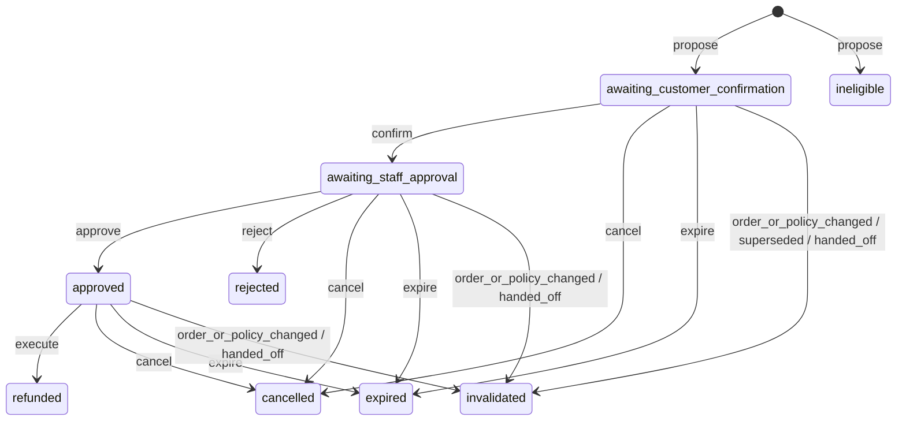
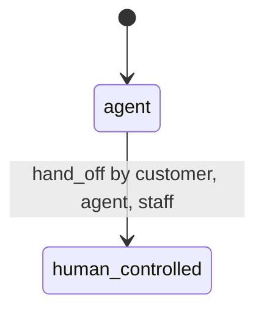

# Proposal states and conversation control

<!-- Generated from refund_agent/states.py by `uv run python -m refund_agent.states`. Do not edit by hand. -->

Open statuses: `awaiting_customer_confirmation`, `awaiting_staff_approval`, `approved`. Final statuses: `refunded`, `ineligible`, `rejected`, `cancelled`, `expired`, `invalidated`.

## Proposal lifecycle (configuration A, the product)

## Transitions

| Event | From | To | Actor | Checks | When |
|---|---|---|---|---|---|
| `propose` | (new) | `awaiting_customer_confirmation` | agent | `actor_owns`, `agent_in_control`, `request_key_consistent`, `valid_values`, `no_confirmed_open_proposal`, `policy_eligible`, `within_remaining` | The request passes the policy; the backend computes and stores the amount. |
| `propose` | (new) | `ineligible` | agent | `actor_owns`, `agent_in_control`, `request_key_consistent`, `valid_values`, `no_confirmed_open_proposal` | The policy refuses; the reasons are stored as policy section IDs and cited to the customer. |
| `confirm` | `awaiting_customer_confirmation` | `awaiting_staff_approval` | customer | `actor_owns`, `proposal_current` | The customer presses confirm on the proposal card. |
| `approve` | `awaiting_staff_approval` | `approved` | staff | `staff_role`, `proposal_current`, `policy_eligible` | A staff member approves in the console. |
| `execute` | `approved` | `refunded` | agent | `actor_owns`, `agent_in_control`, `request_key_consistent`, `first_execution`, `status_approved`, `customer_confirmed`, `staff_approved`, `approval_used_once`, `proposal_current`, `within_window`, `order_status_eligible`, `return_received`, `valid_values`, `within_remaining` | The agent calls execute_refund(proposal_id); one transaction commits the refund and its receipt. |
| `reject` | `awaiting_staff_approval` | `rejected` | staff | `staff_role` | A staff member rejects in the console. |
| `cancel` | `awaiting_customer_confirmation`, `awaiting_staff_approval`, `approved` | `cancelled` | customer | `actor_owns` | The customer declines or cancels before execution. |
| `expire` | `awaiting_customer_confirmation`, `awaiting_staff_approval`, `approved` | `expired` | system | - | The clock passed expires_at; applied by the next action that touches the proposal. |
| `order_or_policy_changed` | `awaiting_customer_confirmation`, `awaiting_staff_approval`, `approved` | `invalidated` | system | - | The order's material version or the policy version differs from the bound one; applied by the next action that touches the proposal. |
| `superseded` | `awaiting_customer_confirmation` | `invalidated` | system | - | The agent creates a newer proposal in the same conversation (same transaction). |
| `handed_off` | `awaiting_customer_confirmation`, `awaiting_staff_approval`, `approved` | `invalidated` | system | - | The conversation becomes human_controlled (same transaction). |

A retry of `execute` on a refunded proposal is not a transition: it returns the same receipt.

## Checks

The last two columns are about `execute_refund` only. Confirm and approve enforce their checks in every
configuration.

| Check | Protects | Verifies | execute in A | execute in C |
|---|---|---|---|---|
| `actor_owns` | INV-1 | The session's customer owns the conversation, the order and the proposal. | enforced | enforced |
| `staff_role` | INV-1 | The session belongs to a staff member. | - | - |
| `agent_in_control` | INV-8 | The conversation is not human_controlled, read inside the same transaction. | enforced | enforced |
| `request_key_consistent` | INV-6 | A repeated request key with the same payload returns the stored result; with a different payload it is a conflict. | enforced | enforced |
| `valid_values` | INV-2 | Quantities and amounts are positive integers, the lines belong to the order, and the currency is the policy currency. | enforced | enforced |
| `no_confirmed_open_proposal` | - | The conversation has no open proposal that the customer already confirmed; an unconfirmed one is superseded. | - | - |
| `policy_eligible` | INV-5, policy:eligible-orders, policy:window, policy:return, policy:payment | Order status, time window, received-back units and a single payment record satisfy the policy; a staff approval cannot override it. | - | - |
| `within_remaining` | INV-4, policy:remaining | Each line's quantity and amount fit what is left on it; at execution the line balance must still be exactly the one the proposal saw. | enforced | enforced |
| `proposal_current` | INV-3, policy:validity | Not expired, the bound order and policy versions are still current, and the content hash matches. | enforced | **not enforced** |
| `first_execution` | INV-6 | If the proposal already has a committed operation, its receipt is returned and nothing runs again. | enforced | enforced |
| `status_approved` | INV-5 | The proposal's status is approved. | enforced | **not enforced** |
| `customer_confirmed` | INV-5, policy:approval | A stored confirmation by the proposal's customer for this content hash. | enforced | **not enforced** |
| `staff_approved` | INV-5, policy:approval | A stored staff approval for this content hash. | enforced | **not enforced** |
| `approval_used_once` | INV-6 | No committed operation uses this approval yet (also a unique constraint in the database). | enforced | enforced |
| `within_window` | policy:window | The proposal was created within the time window after delivery. | enforced | **not enforced** |
| `order_status_eligible` | policy:eligible-orders | The order's status is eligible. | enforced | **not enforced** |
| `return_received` | policy:return | Every refunded unit was received back. | enforced | **not enforced** |

Configuration C exists only in the isolated evaluation harness, on a synthetic database. Because
`status_approved` is not enforced there, `execute` can start from any status except `refunded`; the
evaluator counts a refund without a valid confirmation and approval as an unauthorized committed action.

## Conversation control

Handing off invalidates the conversation's open proposals in the same transaction. From then on every
agent write fails `agent_in_control`. There is no way back to the agent in v1.
